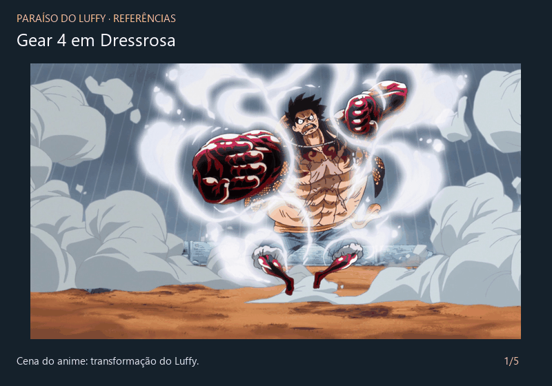

# Paraíso do Luffy

## A Cena

Nosso diorama é inspirado na luta do Luffy contra o Doflamingo, em Dressrosa, de *One Piece*. A ideia foi colocar o Luffy Gear 4 numa ilha pequena, com as ruínas da cidade e a gaiola em volta. O catavento e o girassol ficaram como detalhes no meio dos destroços. Alguns fragmentos ficam suspensos pelo impacto, com poeira no ar e vapor subindo em volta do Luffy.

O Luffy tem três poses. Na primeira ele respira, na segunda fica quicando com o som do anime e na terceira prepara o King Kong Gun. Ainda estamos ajustando a cena.

O chão tem terra em tom ocre, rachaduras e placas levantadas. As paredes têm o topo quebrado e, quando o Luffy chega ao fundo do quique, uma nuvem de poeira se espalha perto dos pés.

O céu procedural tem nuvens em duas camadas, relevo de iluminação, um disco solar visível com halo e um horizonte levemente dourado. No painel, os controles de direção e altura movem o sol e a luz dos objetos juntos. A silhueta animada do Luffy é projetada no chão no sentido oposto ao sol: fica comprida com o sol baixo e curta com o sol alto. Uma sombra de contato suave complementa a projeção durante o quique. A projeção recebe o relevo do piso, mas não projeta sombras sobre as ruínas ou o próprio personagem. A câmera automática usa um ângulo mais baixo para mostrar o personagem e o céu juntos.

O sol começa iluminando a frente do Luffy e percorre a cena automaticamente, variando a direção e a altura; a sombra acompanha o movimento. **Pausar sol** congela a posição. Arrastar qualquer controle também pausa, permitindo escolher a luz manualmente; **Animar sol** retoma dali, sem salto. **Iluminar de frente** reposiciona a luz à frente do personagem e pausa o percurso. **Olhar para o sol** enquadra o disco solar, e **Voltar à cena** retorna ao diorama.

### Como rodar

O projeto usa WebGL2 e JavaScript, sem precisar instalar dependências. Na pasta do repositório, rode:

```sh
python -m http.server 8000
```

Depois abra <http://localhost:8000> em um navegador com suporte a WebGL2. É preciso servir os arquivos por HTTP, porque os shaders e o modelo são carregados com `fetch`.

### Comandos

| Comando | O que faz |
| --- | --- |
| P | Alterna as três poses; a segunda tem a animação de pulo |
| N | Liga ou desliga a neblina |
| G | Mostra ou oculta a gaiola |
| L | Liga ou desliga a iluminação |
| M | Toca ou pausa a música de fundo (também pelo botão no painel) |
| 1 | Volta para a câmera automática |
| 2 | Alterna entre câmera orbital e automática |
| 3 | Entra na câmera livre |
| Arrastar o mouse | Gira a câmera orbital ou muda a direção da câmera livre |
| Scroll | Aproxima ou afasta nas câmeras automática e orbital |
| W / A / S / D | Move a câmera livre para frente, esquerda, trás e direita |
| Q / E | Desce ou sobe na câmera livre |
| Shift | Acelera o movimento da câmera livre |

No painel dá para ajustar o volume da música. A faixa de fundo é **Five Armies**, de Kevin MacLeod, uma instrumental de batalha; a música começa quando apertamos o botão ou M.

## Criadores

- **Pedro H. Soares** — [GitHub](https://github.com/pedrohmsoares)
- **Bryan Felipe** — contato a adicionar.

Trabalho desenvolvido para a disciplina de Computação Gráfica.

## Media kit

Estas foram as referências que usamos para montar o diorama. O GIF reúne duas imagens do anime e as figures que ajudaram a definir as três poses do Luffy.



A animação do quique foi baseada [neste vídeo](https://www.youtube.com/watch?v=AdaTZSJsGdk), no trecho de 1:21 a 1:26. Os links das imagens estão em [referencias/imagens/links.md](referencias/imagens/links.md).

Ainda vamos adicionar de 1 a 3 screenshots da nossa cena e o vídeo de demonstração.

Para remontar o GIF a partir das imagens, rode `python scripts/create_reference_gif.py` (precisa do Pillow).

## Opcionais

Os trechos abaixo são os itens do enunciado que implementamos:

- **Modelos tridimensionais:** “em vez de usar os sólidos próprios ou da TWGL.js, crie ou use modelos tridimensionais de terceiros e carregue-os no seu programa.” Usamos um modelo XPS do Luffy e fizemos o carregador em JavaScript.
- **Skybox, skyphere ou skydome:** “se considerarmos que nosso mundo está definido dentro de um cubo (skybox), podemos colocar uma imagem de textura em cada face interna (são 6) que represente o horizonte naquela direção.” Na nossa cena usamos um skydome com céu e nuvens procedurais, que acompanha a câmera.
- **Animação de personagem:** “faça o personagem executar um clipe de animação que altera as coordenadas de seus vértices ao longo do tempo (técnicas de skinning ou de blend shapes)”. A respiração e o quique usam skinning por ossos.
- **Poses alternativas:** “ao alternar as poses do personagem com P, além de mudar a posição e orientação, coloque-o de fato em outra pose (eg, sentado, deitado, dormindo)”. As poses mudam o corpo, os braços, as pernas e as mãos do Luffy.
- **Câmera de navegação livre com WASD para voar e mouse para mudar direção.** A terceira câmera também tem Q/E para movimento vertical.
- **Neblina:** “funcionalidade acrescentada por comando do teclado (N), podendo ser habilitada e desabilitada durante a execução”. A névoa é mais densa perto do chão, com transição suave ao ligar e desligar.
- **Material transparente:** “tenha algo como vidro ou outra coisa que seja semitransparente. Detalhe: objetos transparentes devem ser desenhados por último.” A gaiola é translúcida e é desenhada depois dos objetos opacos.
- **Efeitos de partículas:** “para simular fenômenos como fogo, fumaça, água etc.” Usamos partículas para o vapor ao redor do Luffy, a poeira suspensa e as nuvens de poeira que surgem a cada quique. Elas nascem, sobem e desaparecem aos poucos.
- **Chão com relevo:** “em vez de plano, faça com que o chão tenha relevo.” Deslocamos os vértices do chão, mantendo o centro plano para apoiar o personagem, e acrescentamos placas de pedra levantadas.
- **Música, efeitos sonoros e/ou som ambiente:** “inclua música de fundo, sons ambiente e efeitos sonoros (este último, caso haja algum tipo de interação)”. Ao entrar na segunda pose com P, o som acompanha o quique. Nas outras poses ele para.

## Créditos

- *One Piece*, seus personagens e a cena de referência: Eiichiro Oda e Toei Animation. [Vídeo do Gear 4](https://www.youtube.com/watch?v=AdaTZSJsGdk) e [AMV de referência para a atmosfera](https://www.facebook.com/newamvsanimes/videos/amvluffy-vs-doflamingoone-piece/396820780967400/).
- Imagens do anime usadas no GIF: [transformação Gear 4, via Critical Hits](https://criticalhits.com.br/anime/em-qual-episodio-de-one-piece-luffy-usa-o-gear-4-pela-primeira-vez/) e [gaiola, via Reddit](https://preview.redd.it/doflamingos-birdcage-is-one-of-the-most-ridiculous-feats-in-v0-bqkihpka8mh81.png).
- Fotos das figures usadas como referência: [pose neutra, via Mercado Livre](https://www.mercadolivre.com.br/one-piece-luffy-gear-4-boundman-megahouse-bandai/up/MLBU3889418805) e [ataque básico, via Geek Fanáticos](https://www.geekfanaticos.com.br/produto/luffy-gear-4-the-bound-man-king-of-artist-one-piece-banpresto-75587). A origem da foto do King Kong Gun ainda precisa ser identificada; recebemos a miniatura pelo Google Imagens.
- Modelo do Luffy Gear 4: *One Piece Fighting Path*, disponibilizado por **o_dv89_o**, conforme a identificação do modelo. Falta adicionar o link da página de origem.
- [TWGL.js](https://twgljs.org/): usada para as matrizes, vetores e primitivas geométricas.
- Música de fundo: **Five Armies**, Kevin MacLeod ([incompetech.com](https://incompetech.com/music/royalty-free/index.html?isrc=USUAN1100875)). Licenciada sob [Creative Commons Attribution 4.0](https://creativecommons.org/licenses/by/4.0/). Arquivo original, sem edição. Atribuição também em [assets/sounds/CREDITS.md](assets/sounds/CREDITS.md).
- Código das aulas de Computação Gráfica: referência para os shaders e utilitários WebGL.
- Texturas do chão, pedras e ruínas: links de origem a adicionar.
- Efeito sonoro `luffyBouncing.mp3`: fonte a adicionar.
